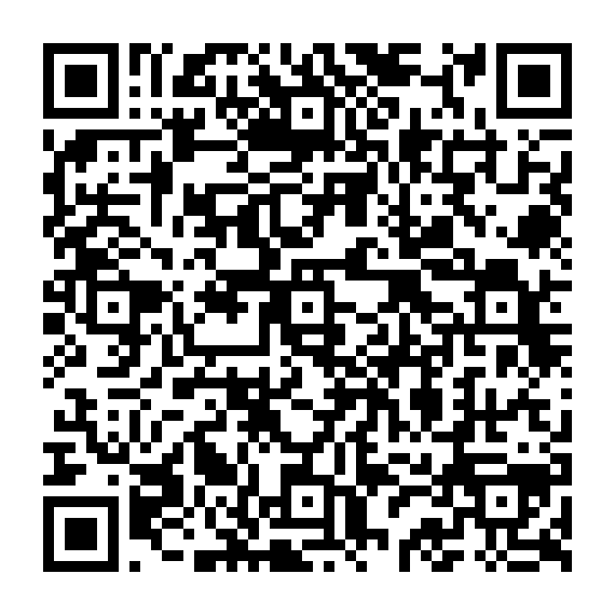

# Android testing build

Scan this QR code on your Android phone to download the signed APK:

[Download the APK](https://github.com/S3corper/GroceiesTracker/raw/refs/heads/codex/android-apk-testing/downloads/android/grocery-tracker-release.apk)

Open the downloaded APK, allow installation from your browser or file manager if Android asks, then install **Grocery Tracker**. Sign in with your existing website account and select the same workspace. Android 8.0 or newer and an internet connection are required.

This is the existing 1.0.0 APK, published as-is for testing. It connects to the existing live website and backend, so changes made in the app affect the same account and household data. Use a separate test account or workspace if you want to keep test records separate.

[Installation/build guide](../../artifacts/groceries-tracker-android/README.md) · [Verification report](../../artifacts/groceries-tracker-android/VERIFICATION.md) · [SHA-256 checksum](grocery-tracker-release.apk.sha256) · [Printable SVG QR](download-qr.svg)
